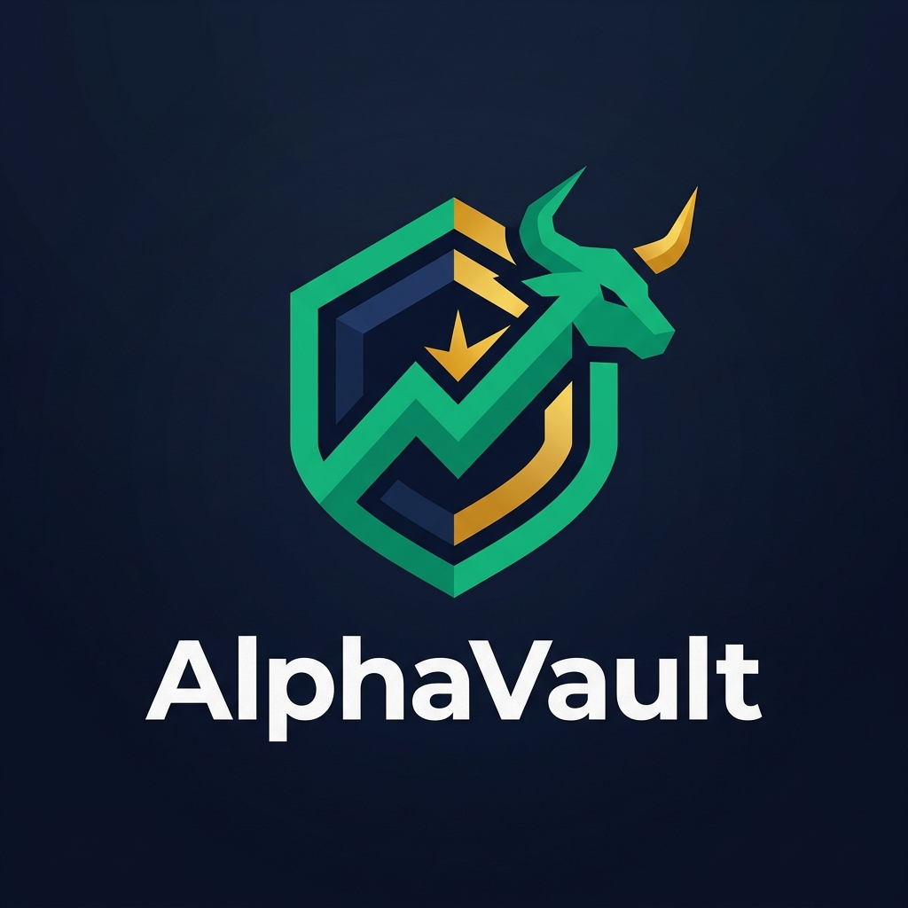

# 📈 AlphaVault

<p align="center">
  
</p>

> Autonomous DeFi trading agent on CROO CAP — monitoring, signals, execution, and transparent P&L accounting

## Track

**DeFi / On-chain Ops Agents** — Monitoring, alerts, execution

## Quick Start

```bash
npm install
cp .env.example .env
# Fill in your API keys in .env
npm run dev
```

## Services

| Service | Price | SLA | Description |
|---|---|---|---|
| Market Monitor & Alerts | 0.25 USDC | 15 min | Real-time market snapshots and alert triggers |
| Trading Strategy Signals | 1.00 USDC | 20 min | Technical + on-chain signal generation |
| Trade Execution & Accounting | 2.00 USDC + 0.5% | 30 min | Execute trades with full P&L reporting |
| Portfolio Health Check | 0.75 USDC | 15 min | Wallet analysis and risk assessment |

## Project Structure

```
src/
├── index.ts                  # Entry point
├── provider.ts               # CROO CAP provider logic
├── config.ts                 # Environment config
├── strategies/               # Trading strategies
│   ├── engine.ts             # Strategy router
│   ├── momentum.ts           # Momentum signals
│   ├── mean-reversion.ts     # Mean-reversion
│   ├── breakout.ts           # Breakout detection
│   ├── dca.ts                # Dollar-cost averaging
│   └── arbitrage.ts          # Cross-DEX arbitrage
├── market/                   # Market data
│   ├── price-feed.ts         # Price aggregation
│   ├── technical.ts          # RSI, MACD, BB
│   ├── onchain-metrics.ts    # Whale flows, TVL
│   ├── sentiment.ts          # Fear & Greed
│   └── scanner.ts            # Token screener
├── execution/                # Trade execution
│   ├── router.ts             # DEX routing
│   ├── tx-builder.ts         # Transaction builder
│   ├── simulator.ts          # Dry-run simulation
│   └── risk-manager.ts       # Stop-loss, limits
├── reporting/                # Accounting
│   ├── pnl-calculator.ts     # P&L computation
│   ├── trade-logger.ts       # Trade log
│   ├── portfolio-analyzer.ts # Portfolio analysis
│   └── accounting-hash.ts    # Verifiable hashing
├── monitoring/               # Real-time monitoring
│   ├── alert-engine.ts       # Alert conditions
│   ├── whale-tracker.ts      # Whale monitoring
│   └── position-monitor.ts   # Position tracking
├── a2a/                      # Agent-to-Agent
│   └── research-requester.ts # Hire OmniResearch
└── utils/
    ├── logger.ts
    ├── hash.ts
    └── rate-limiter.ts
```

## Full Plan

See [PLAN.md](./PLAN.md) for the complete implementation plan with architecture diagrams, code examples, and milestones.
